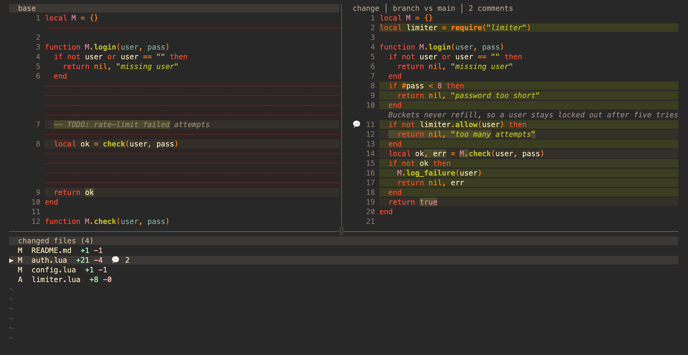
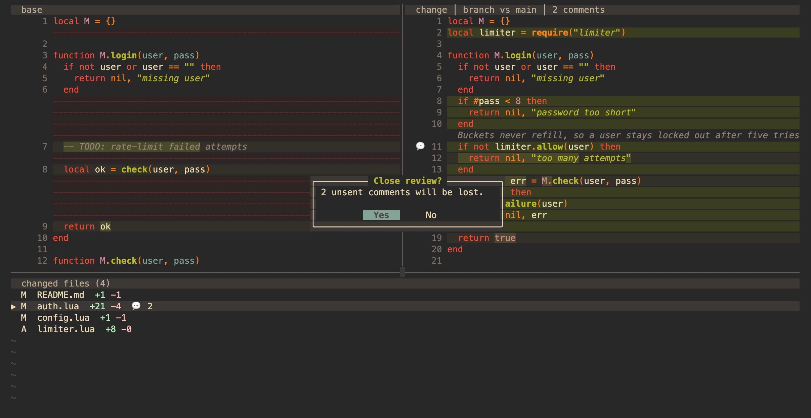

# reviewr.nvim

A multiplexer-agnostic Neovim plugin that brings [herdr-reviewr](https://github.com/persiyanov/herdr-reviewr)-style code review to Neovim: open a diff of two branches, comment on lines or ranges, and send the whole review to a running coding agent (Claude Code, Codex, OpenCode, Aider, …), entirely from inside Neovim.






## Features

- A review tab of its own: side-by-side native Vim diff (`]c`/`[c`, folds) over a **changed-files panel** along the bottom, like an octo.nvim review
- Scopes: uncommitted, staged, branch (everything on the branch, committed or not, against its merge base with the default branch), and **turn**: what changed since the last turn baseline
- Diffs cover files git tracks: commits, edits to tracked files, and new files once `git add`ed; untracked files are left out
- Line comments on a line or range, anchored by identity (file, side, start, end), never row index; each records the content its side showed (a commit, the index or the working tree) and shows only in views of that content
- In-memory comment store by design (ephemeral; close drops them, and asks first while any is unsent)
- All-or-none export: clipboard, agent send, or filesystem inbox
- Mux-agnostic send to a running agent: Neovim `:terminal` → tmux → Rex → WezTerm → inbox → clipboard
- Private `refs/reviewr/*` baselines only; never mutates worktree/index/branches. Baselines of removed worktrees, and in Rex of closed terminals, are pruned when a review opens
- Configurable keymaps, events (`User Reviewr…`), leveled logging
- Runs from the shell: `nvim -d …` or `:ReviewrOpen`

## Requirements

- Neovim ≥ 0.10
- git

## Install

Point your coding agent at this repository and ask it to install reviewr.nvim. [INSTALL.md](INSTALL.md) is written for agents: it adds the plugin to Neovim, installs the agent skill (`skills/reviewr-nvim`) so the agent can open reviews for you and act on the comments, and sets up the Rex key binding when you use Rex.

By hand, with lazy.nvim:

```lua
{
  "paul-enz/reviewr.nvim",
  cmd = { "ReviewrOpen", "ReviewrScope", "ReviewrComment", "ReviewrTurn", "ReviewrExport", "ReviewrClear" },
  opts = {},
}
```

## Rex

`rex/reviewr/init.lua` is a Rex config module. Loaded from `~/.config/rex/init.lua` (see below), it binds cmd+r to show or hide a review beside the focused terminal. The first press opens a review of the terminal's branch, committed or not, against the default branch, in a split to its right; the next press hides it, still running with its comments, and the press after brings it back.

Pressed in an agent's terminal, cmd+r opens a review **paired with that agent**: `s` sends to it without asking (`S` still offers the picker), the review follows only that agent's turns, and its turn baseline is its own. Run several agents, each with its own review beside it; with one git worktree per agent, each review's turn view shows exactly its agent's last turn. Agents sharing one working copy see each other's edits in their turn views, since git can't tell who wrote what. Pressed in any other terminal, cmd+r keeps one unpaired review per repository. `setup({ key = "...", command = "ReviewrOpen" })` changes the key or what is reviewed.

### Share Neovim's managed copy with Rex

Rex loads the module straight from the copy your Neovim plugin manager installed, so both halves stay on the same version and the plugin manager updates them together. Install the plugin in Neovim first, then add this to Rex's config:

```lua
-- ~/.config/rex/init.lua
do
  local data_home = os.getenv("XDG_DATA_HOME") or os.getenv("HOME") .. "/.local/share"
  -- lazy.nvim; with vim.pack (Neovim 0.12+) use
  -- data_home .. "/nvim/site/pack/core/opt/reviewr.nvim/rex/reviewr/init.lua"
  local path = data_home .. "/nvim/lazy/reviewr.nvim/rex/reviewr/init.lua"
  local ok, reviewr = pcall(dofile, path)
  if ok then reviewr.setup() end -- or setup({ key = "ctrl+a>r" }) to pick another key
end
```

The path assumes Neovim's default app name and data directory on macOS or Linux. For another plugin manager or a custom data directory, point it at `rex/reviewr/init.lua` inside that manager's copy of the plugin.

Keep the `pcall`: Rex stops loading `init.lua` at a Lua error, so if the Neovim copy is removed, an unguarded `dofile` would take every binding after it with it. Guarded, only cmd+r goes.

Run `rex config reload` after configuring Rex and after every plugin update: Rex doesn't watch its files, so it keeps running the old module until reloaded.

### What the plugin does inside Rex

Inside Rex the plugin also:

- lists every terminal in one `rex do` round trip, so `s` stays quick with many panes open;
- brings the agent's terminal forward after sending (`focus_agent`);
- watches the program status of agents working in the repo and of any agent it sends to: when one starts a turn, the turn baseline is snapshotted (`baseline_trigger = "agent"`, the default in Rex), so `:ReviewrScope turn` shows exactly what that turn changed; when it finishes, the open review reloads (`refresh_on_agent`);
- copies through OSC 52 as well as the `+` register, so `y` reaches your clipboard when Neovim runs on another machine.

## Shell usage

```sh
# raw diff (no comment plumbing)
nvim -d <(git show HEAD:file.txt) <(git show feature:file.txt)

# integrated review session
nvim -c 'cd /path/repo' -c 'ReviewrOpen HEAD feature'
```

## Commands

| Command | Description |
|---|---|
| `:ReviewrOpen [base] [head] [label]` | open a review; no args reviews uncommitted changes, `{base}` alone reviews the working tree against its merge base with base, `{base} {head}` diffs the commits of head against its merge base with base |
| `:ReviewrScope {scope}` | switch scope: `uncommitted`, `staged`, `branch` (the working tree against its merge base with the default branch, or the base picked with `gb`), `turn`, `commit {sha}` |
| `:[range]ReviewrComment {text}` | comment on the current line or range |
| `:ReviewrTurn` | snapshot the working tree as the turn baseline |
| `:ReviewrExport {clipboard\|send\|inbox}` | export all comments (all-or-none) |
| `:ReviewrClear` | clear comments |

## Keys

The bar above the change pane always shows the next step. `?` lists every key.

| Key | Action |
|---|---|
| `c` | comment on the current line, or the visual selection |
| `e` | edit the comment under the cursor |
| `d` | delete the comment under the cursor |
| `n` / `N` | next / previous comment |
| `s` | send every comment to the running agent (the paired one, if any) |
| `S` | send, choosing the agent |
| `y` | copy every comment |
| `l` | list comments |
| `]c` / `[c` | next / previous change |
| `f` / `F` | next / previous changed file |
| `r` | reread the changes from git and the working tree |
| `u` `b` `t` | view: uncommitted / branch / last turn |
| `gc` | pick a commit and review just that commit |
| `gb` | pick the base branch for the branch view |
| `?` | all keys |
| `q` | close. With unsent comments (new, or edited since the last send or copy) it asks once: Enter closes, Right then Enter or Esc keeps reviewing. A review cmd+r opened closes its pane too |

In the changed-files panel, `<CR>` opens the file under the cursor and `q` closes the review.

The pickers (`gc`, `gb`, `S`) open a small list: `j`/`k` or the arrows move, Enter picks, Esc cancels.

All buffer-local and remappable through the `keymaps` option or `require("reviewr.keymaps").set_defaults()`.

## Agents

`s` pastes the review into a running agent (`claude`, `codex`, `opencode`, `aider`, `goose`, `cline`, `pi`, or the programs the `agents` option names; a review paired with an agent always recognises it). It looks in:

1. Neovim `:terminal`s whose processes include an agent;
2. tmux panes in the repo running an agent (inside tmux);
3. Rex terminals running an agent: any terminal in Neovim's own Rex session, and terminals in other sessions working in the repo (inside Rex);
4. WezTerm panes in the repo running an agent (inside WezTerm).

With one agent found it sends straight away; with several, a picker lists them, the likeliest first, with each terminal's title. With none it writes the inbox file, and failing that copies to the clipboard. The `adapters` option limits which of these are tried.

## Agent send protocol

Sends a stable envelope:

```
@@REVIEW_BEGIN v1
id: <nonce>
source: reviewr.nvim
repo: /abs/path
file: path/relative        (only when every comment is on one file)
range: 42-88               (only for a single comment)
created: ISO8601
format: markdown
---
### path/relative:42-88 (right, working tree)
<comment>

@@REVIEW_END
```

Each heading names the side and the content it showed: `working tree`, `index`, or `commit <sha>` (read it with `git show <sha>:<path>`; a left-side comment on a renamed file names the old path). Every export carries every comment; one that succeeds marks them sent, so closing no longer asks about them.

Default delivery is **queue** (pasted into the agent input, no Enter); set `send_mode = "submit"` to also submit. Filesystem inbox writes the same envelope to `<repo>/.reviewr/inbox/`, which git ignores.

## Configuration

```lua
require("reviewr").setup({
  baseline_trigger = "auto",   -- auto (agent in Rex, else open) | open | agent | first_comment | manual
  focus_agent = true,          -- bring the agent's terminal forward after sending
  refresh_on_agent = true,     -- reload the review when a watched agent finishes
  log_level = "info",
  send_mode = "queue",         -- queue | submit
  private_ref_prefix = "refs/reviewr",
  keymaps = true,              -- false, or a table such as { send = "S" }
  files_panel_height = 10,     -- rows of the changed-files panel
  adapters = { "neovim-terminal", "tmux", "rex", "wezterm", "filesystem-inbox" },
  agents = { "claude", "codex", "opencode", "aider", "goose", "cline", "pi" }, -- programs that count as agents
})
```

## Testing

```sh
nvim --headless -u NONE -l tests/run.lua
```

## License

MIT
